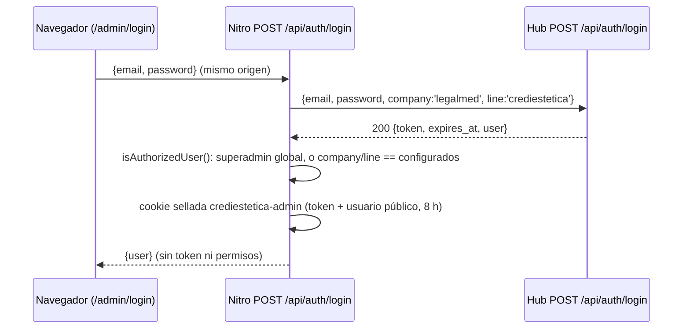

# 02 · Autenticación y tenancy

Contrato del Hub: Hub `docs/api/crediestetica/02-autenticacion-y-tenancy.md`. Aquí, cómo lo aplica esta web.

## 1. Resolución de empresa y línea

| Mecanismo | Cómo lo envía la web | Archivo |
|---|---|---|
| `X-Tenant-Linea` | En **todas** las lecturas y escrituras públicas a `/v1/web/*`, con el valor de `runtimeConfig.wellezyLineSlug` (`crediestetica`). Nunca vacío: sin slug no se hace la petición | `server/utils/wellezy.ts` (`tenantLine`, `wellezyPublicGet/Post`) |
| `X-Tenant-Domain` | **No se envía** (Hub lo admite; esta web no lo usa) | — |
| `company` + `line` | Cuerpo de `POST /auth/login` con `wellezyCompanySlug` (`legalmed`) y `wellezyLineSlug` | `wellezyLogin` |
| Abilities del token | El Hub fija el contexto del token; la web no lo cambia | — |
| HMAC (`X-Hub-Key-Id`…) | Solo en el pago de valoración; empresa y línea salen de la integración en Hub | `server/utils/valuationPayment.ts` |

Los **IDs** de empresa/línea (16 y 4) no se usan en ningún código: son referencia de una copia local (`docs/migration/DECISIONS.md` D-11). Valores de producción: `NO VERIFICADO`.

## 2. Sesión del panel `/admin` (único flujo con usuario)

- El Bearer nunca sale del servidor. Cada acción del CMS llama a `wellezyRequest(event, token, …)` con el token de la sesión.
- `GET /api/auth/me` de la web **revalida** contra Hub `/auth/me`; 401/403 limpian la sesión.
- Permisos: la web no reenvía los de Hub; deriva banderas (`toPublicUser`: `canViewProcedures`, `canViewNews`, `canViewPatients`, `canViewRecommendations`, `canViewMicrosites`, `canCreatePrp`/`canEditPrp`/`canDeletePrp`, `canEditRate`, `canEditContent`, `canAccessConfiguration`, `mustChangePassword`). Hub impone cada permiso en cada llamada; las banderas son informativas.
- Roles reconocidos por **nombre** (`administrador de contenido de línea`, `diseñador gráfico`, `admin`, `superadmin`, `super_admin`) o por `NUXT_CONTENT_EDITOR_ROLE_IDS` (vacía). No fijar IDs de rol.
- Con `must_change_password = true`, `/api/admin/**` responde `403 password_change_required` (`server/middleware/admin-password-change.ts`).
- No existe refresh: al vencer (480 min en Hub, 8 h la cookie) hay que volver a iniciar sesión.
- Archivos: `server/api/auth/*.ts`, `server/utils/auth.ts`, `providers/WellezyAuthProvider.ts`, `middleware/admin-auth.global.ts`.

Tests: `tests/security/panel-access.test.ts`, `password-change.test.ts`, `authorization.test.ts`, `admin-route-guard.test.ts` (Hub simulado; incluidas en la suite de `node --test`). Login con credenciales reales de Crediestética: `NO VERIFICADO` (sin credenciales en la auditoría; `docs/migration/INTEGRATION_BLOCKERS.md` B-07, B-09).

## 3. Autenticación servidor a servidor (pago de valoración)

La web firma con `HMAC-SHA256(secreto, "POST\n<ruta>\n<timestamp>\n<nonce>\n<sha256(cuerpo)>")` y envía `X-Hub-Key-Id`, `X-Hub-Timestamp`, `X-Hub-Nonce`, `X-Hub-Signature` e `Idempotency-Key` desde `server/utils/valuationPayment.ts`. Las rutas son **solo de servidor**: el navegador llama a `/api/forms/valuation-payment/*` (BFF) y nunca ve la firma ni el secreto. Detalle: [06](06-valoraciones-y-pagos.md).
