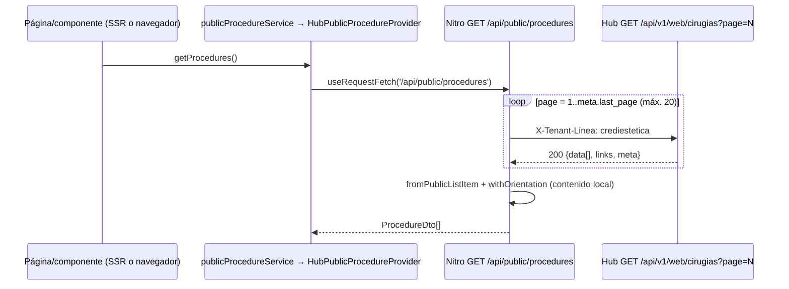

# 03 · Consumo de catálogos (procedimientos y categorías)

Contrato del Hub: Hub `docs/api/crediestetica/03-catalogos-y-procedimientos.md`. No se repite aquí.

## 1. Lista de procedimientos

| Elemento | Dato |
|---|---|
| Archivos | `providers/HubPublicProcedureProvider.ts` → `server/api/public/procedures/index.get.ts` → `server/utils/procedures.ts` (`fetchPublicProcedureRows`, `fromPublicListItem`, `withOrientation`) |
| Paginación | La web recorre **todas** las páginas de 15 (`HUB_PROCEDURES_MAX_PAGES = 20`). Falla con `503 invalid_response` si falta `meta.last_page`, si cambia entre páginas o supera 20: nunca devuelve una lista parcial |
| Transformación | `nombre→name`, `slug→id/slug`, `categoria_slug→category`, `descripcion_corta→shortDescription`, `imagen_destacada→image`, `destacado`, `tiene_recomendaciones_*`, `recomendaciones→recomendaciones{fuente, paginaSlug}`. La lista deja `whatIsIt`, `galeria` y fichas vacías. `withOrientation` añade la «orientación» **local** (no viene del Hub) |
| Lista vacía | `200 {data: []}` es válido: `pages/procedimientos/index.vue` muestra la cuadrícula vacía (no el aviso de error). Un fallo del Hub muestra `CommonHubUnavailable` con botón de reintento |
| Caché | `Cache-Control: no-store` en la ruta de Nitro; sin caché propia en el cliente (`useAsyncData` por página) |
| Consumidores | `pages/procedimientos/index.vue`, `pages/procedimientos/[slug].vue` (relacionados), `components/home/ProceduresSection.vue`, `components/layout/Navbar.vue` (menú), `components/forms/ValuationRequest.vue` (selector), `components/prp/PrpLeadForm.vue`, `components/recommendations/ProcedureRecommendationIndex.vue`, `composables/useSimulator.ts`; sitemap (`server/utils/procedureSitemap.ts`, «todo o nada») |
| Pruebas | `tests/procedures/*`, `tests/navigation/procedures-menu.test.ts` (Hub simulado) |

## 2. Detalle de un procedimiento

| Elemento | Dato |
|---|---|
| Flujo | `publicProcedureService.getProcedureBySlug(slug)` → `GET /api/public/procedures/{slug}` → Hub `GET /v1/web/cirugias/{slug}` |
| Archivos | `server/api/public/procedures/[slug].get.ts`, `server/utils/procedures.ts` (`fromPublicDetail`, `fromPublicSections`), `shared/utils/contentBlocks.ts` (`fromPublicBlock`) |
| Validación previa | slug `^[a-z0-9]+(?:-[a-z0-9]+)*$`; si no, 404 propio sin llamar al Hub |
| Transformación | `procedimiento→whatIsIt`, `galeria→galeria`, `secciones→secciones` (re-valida bloques: imágenes solo `http(s)`, YouTube e Instagram solo hosts permitidos; adapta el formato anterior sin `blocks`), `ficha_tecnica{tipo_anestesia,tiempo_quirurgico,tiempo_recuperacion}`, `datos_paciente{edad_minima,edad_maxima,imc_maximo}` y `perfil_paciente→condiciones_medicas_compatibles`, `recomendaciones_post/revision` (HTML o lista histórica), `recomendaciones`, `seo` |
| 404 | El Hub responde `404` → la web `404 «El procedimiento no existe.»` (el provider devuelve `null`); si el mensaje contiene «Tenant» se trata como error de configuración (503 `reason: tenant`) |
| Consumidores | `pages/procedimientos/[slug].vue`, `components/recommendations/ProcedureRecommendation.vue` |

### Campos del Hub que la web descarta (lectura del mapper)
`fromPublicDetail` **no mapea**: `ficha_tecnica.hospitalizacion`, `ficha_tecnica.visibilidad_resultados`, `adicionales_basicos`, `tecnicas`, `adicionales_complementarios`, `complicaciones`, `candidatos_ideales`, `candidatos_no_ideales`, `restricciones_medicas`, `clinicas_asociadas`, `galeria_antes_despues`, `tiene_datos_paciente`, `categoria.nombre`. `types/procedure.ts` declara `galeria_antes_despues?` pero el mapper público no lo rellena ni las páginas lo usan. Las clínicas aliadas de la web son **locales** (`clinics.json`), no las del Hub. `cicatrizacion_minima` se interpreta solo si es exactamente `true`.

## 3. Categorías

| Elemento | Dato |
|---|---|
| Flujo | Páginas → `GET /api/public/procedure-categories` → Hub `GET /v1/web/categorias-cirugias` |
| Archivo | `server/api/public/procedure-categories.get.ts` |
| Salida web | `[{slug, name, count}]` (a partir de `slug`, `nombre`, `cirugias_count`; la etiqueta la deriva la web del slug y ofrece el nombre real solo como sugerencia: `docs/migration/DECISIONS.md` D-14/D-17) |
| Manejo de error | Solo aporta nombres reales: `pages/procedimientos/index.vue` usa `$fetch('/api/public/procedure-categories').catch(() => [])` y, si falla, deriva la etiqueta del slug. El filtro por tipo de la página sale de las categorías de los procedimientos ya cargados |
| Consumidores | `pages/procedimientos/index.vue`, `pages/procedimientos/[slug].vue` |
| Administración de categorías | **No existe** en la web (bloqueo B-08, `docs/migration/INTEGRATION_BLOCKERS.md`) |
| Filtro `?categoria=` del Hub | **No usado** por la web: filtra en cliente con la lista completa |

Estado de datos publicados en el entorno real: `NO VERIFICADO` (la copia local auditada devolvía listas vacías, `docs/migration/HUB_READ_VERIFICATION.md`).
