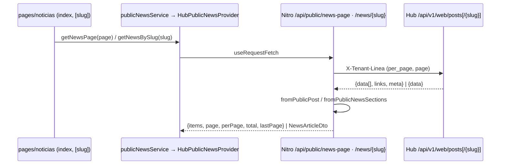

# 04 · Consumo de contenidos (noticias, recomendaciones, pacientes)

Contratos del Hub: Hub `docs/api/crediestetica/04-contenidos-web.md` y `05-pacientes-y-secciones.md`.

## 1. Noticias

| Elemento | Dato |
|---|---|
| Archivos | `providers/HubPublicNewsProvider.ts`, `server/api/public/news/index.get.ts` (`per_page=50`, lista simple), `news-page.get.ts` (paginado), `news/[slug].get.ts`, `server/utils/news.ts` (`fromPublicPost`, `fromPublicNewsSections`) |
| Paginación | `news-page`: `per_page` por defecto **12**, tope **50** (igual que Hub); lee `meta.current_page`, `per_page`, `total`, `last_page` con valores de respaldo (`items.length`, `1`) |
| Transformación | `slug→id/slug`, `cover_url→coverImage`, `published_at→publishedAt`, `author_name→author` (solo si es cadena; `null` ⇒ sin autor), `youtube_url/instagram_url`, `seo`, `secciones→sections` (bloques por columna re-validados; adapta secciones sin `blocks` desde `content`/`content_left`/`content_right`) |
| `author_name` | El Hub devuelve `null` para la línea `crediestetica` (cambio **sin confirmar** en Hub); la web **no depende** del autor |
| Lista vacía | `data: []` ⇒ la página muestra el estado vacío |
| 404 | Slug inválido o Hub `404` ⇒ 404 «No encontrado»; con «Tenant» ⇒ 503 |
| Consumidores | `pages/noticias/index.vue` (`getNewsPage`), `pages/noticias/[slug].vue` (`getNewsBySlug`) |
| Pruebas | `tests/news/pagination.test.ts`, `tests/news/admin-module.test.ts` |

## 2. Recomendaciones

Dos contratos coexisten en el Hub; la web consume ambos:

| Funcionalidad | Servicio | Ruta Nitro | Endpoint Hub |
|---|---|---|---|
| Menú de páginas (histórico) | `publicRecommendationsService.getPages()` | `/api/public/recommendations` | `/v1/web/recommendation-pages` |
| Página | `getPage(slug)` | `/api/public/recommendations/{slug}` | `/v1/web/recommendation-pages/{slug}` |
| Árbol tema → subtemas | `getTopics()` | `/api/public/recommendation-topics` | `/v1/web/recommendation-topics` |
| Subtema | `getSubtopic(topic, subtopic)` | `/api/public/recommendation-topics/{topic}/{subtopic}` | `/v1/web/recommendation-topics/{topic}/{subtopic}` |

Archivos: `providers/HubPublicRecommendationsProvider.ts`, `server/api/public/recommendations/*`, `server/api/public/recommendation-topics/*`, `server/utils/recommendations.ts` (`fromPublicPage`), `shared/utils/recommendationTree.ts` (`fromPublicTopics`, `fromPublicSubtopic`).

- Transformación `fromPublicPage`: `grupo→group`, `menu_label→menuLabel`, `video_url→videoUrl`, `image_url→image`, `content`, `cirugia_slug→procedureSlug`; `published = true` (Hub solo entrega publicadas); el campo `vinculada` del Hub **no** se mapea.
- El árbol: el contrato está en `shared/utils/recommendationTree.ts` y `tests/recommendations/tree-contract.test.ts`; la web construye rutas con **slugs**, no con `path` (depende de la línea).
- Lista vacía válida (`[]`); el árbol vacío se trata con `.catch(() => [])` en `ProcedureRecommendationIndex.vue`.
- Consumidores: `components/layout/Navbar.vue` (menú, `Promise.allSettled` con procedimientos), `pages/recomendaciones/[slug].vue`, `pages/recomendaciones/[topic]/[subtopic].vue`, `components/recommendations/ProcedureRecommendation.vue` y `ProcedureRecommendationIndex.vue` (páginas `cuidados`/`revision` por procedimiento).
- **No consumidos:** `GET /v1/web/recommendation-topics/{topic}`, `GET /v1/web/recommendation-pages/{slug}/items/{itemSlug}` y `GET /v1/web/cirugias/{slug}/recomendaciones/{tipo}`.
- Pruebas: `tests/recommendations/*` (Hub simulado; el `FakeHub` de `harness.ts`).

## 3. «Nuestros pacientes»

| Elemento | Dato |
|---|---|
| Flujo | `fetchPatientSection()` → `/api/public/patient-section` → Hub `/v1/web/patient-section` |
| Archivos | `providers/HubPublicTestimonialsProvider.ts`, `services/PublicTestimonialsService.ts`, `server/api/public/patient-section.get.ts`, `server/utils/patients.ts` (`fromPublicSection`) |
| Transformación | `visibility.videos/before_after` ⇒ `visibility.videos/beforeAfter` (`!== false`); `videos`/`instagram` ⇒ `{id: external_id, title, url, active: true}`; `before_after` ⇒ `{title, description, beforeImage, afterImage, published: true}`; `referral` ⇒ `{title, content}` |
| Lista vacía | Arreglos vacíos son válidos; la bandera `visibility` decide si se muestra la sección |
| Consumidores | `components/layout/Navbar.vue`, `components/testimonials/TestimonialsNav.vue`, `pages/testimonios/index.vue`, `antes-y-despues.vue`, `programa-de-referidos.vue` (todas con `useAsyncData('patient-section', …)`, clave compartida) |
| Pruebas | `tests/patients/*` |
