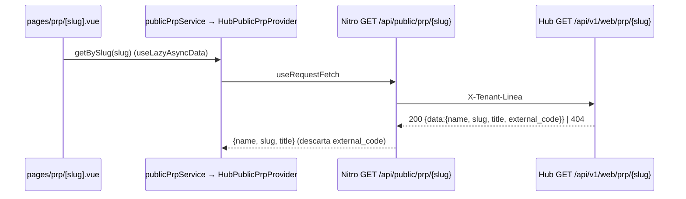
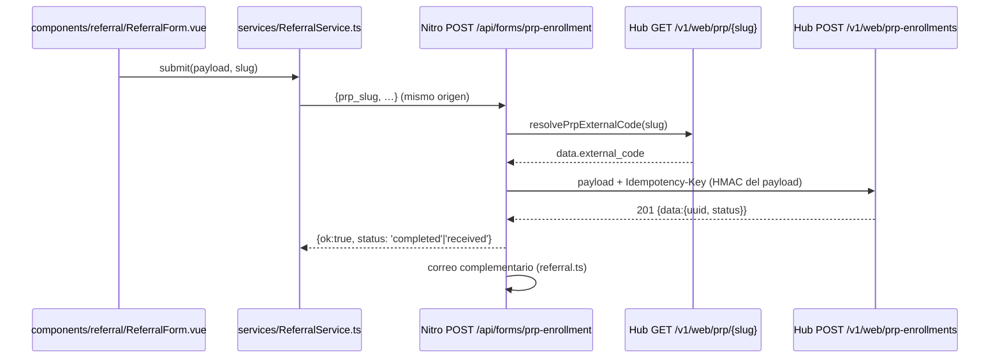

# 05 · Pacientes y PRP

Contratos del Hub: Hub `docs/api/crediestetica/05-pacientes-y-secciones.md` y `06-prp-y-referidos.md`.

## 1. Pacientes y CRM

- **Contenido público «Nuestros pacientes»:** ver [04 §3](04-consumo-de-contenidos.md#3-nuestros-pacientes).
- **Lectura de pacientes (CRMEDIC, `PatientService`):** servicios PHP internos del Hub **sin ruta HTTP**. Esta web **no los consume** ni puede hacerlo. Estado: no consumido; sin API pendiente decidida.
- **Alta del cliente en el CRM tras el pago de la valoración:** en el árbol de trabajo la hace el **Hub** (post-aprobación), no esta web; antes (en `HEAD`) la hacía Nuxt con `server/utils/crmClientStore.ts` (eliminado sin confirmar). Ver [06](06-valoraciones-y-pagos.md).

## 2. Micrositio PRP

| Elemento | Dato |
|---|---|
| Archivos | `server/api/public/prp/[slug].get.ts`, `providers/HubPublicPrpProvider.ts`, `services/PublicPrpService.ts`, `pages/prp/[slug].vue` |
| Validación | slug `^[a-z0-9]+(?:-[a-z0-9]+)*$` (≤255) o 404 sin llamar al Hub |
| Transformación | Conserva **solo** `name`, `slug`, `title`; el `external_code` **no sale al navegador** |
| Errores | Hub `404` ⇒ 404 «No encontrado» (con «Tenant» se deja rastro en log); respuesta no conforme o no 200 ⇒ 503 |
| Interruptor | `disabled-features.ts` devuelve 404 en `/api/public/prp` si `PRP_ENABLED` se apaga (hoy `true`) |

## 3. Inscripción PRP

| Elemento | Dato |
|---|---|
| Archivos | `server/utils/prpEnrollment.ts` (envío), `server/utils/prpReferrer.ts` (`resolvePrpExternalCode`), `shared/utils/prpEnrollment.ts` (validaciones y slug), `services/ReferralService.ts`, `components/referral/ReferralForm.vue`, `server/utils/referral.ts` (correo) |
| Tenant y cabeceras | `wellezyPublicPost` ⇒ `X-Tenant-Linea` + `Idempotency-Key` |
| `external_code` | Nunca viene del navegador: el navegador envía solo `prp_slug`; el servidor lo resuelve con el Hub. Sin referidor válido no hay inscripción (sin código por defecto ni derivado del slug) |
| Idempotencia | Clave = HMAC (secreto de servidor: `NUXT_SESSION_PASSWORD`) del payload completo: un reintento idéntico (también tras timeout) produce la misma clave; sin reintentos automáticos |
| Límite propio | 6 inscripciones cada 10 min por IP (en memoria, `formMail.ts`); el Hub añade 10/min por IP |
| Respuestas | Éxito `{ok: true, status}`; Hub no disponible ⇒ `503 hub_unavailable` (reintentable); sin confirmación ⇒ `502 unconfirmed` («no se duplicará»); slug no válido ⇒ 404/422 (`referrer_not_found`, `referrer_required`) |
| Estado `status` | `completed` solo si el CRM confirmó. **Hoy el gateway del Hub es `NullPrpCrmGateway`, que no envía nada: toda inscripción queda `received`**. No se debe presentar al usuario como «registrada en el CRM» |
| Pruebas | `tests/security/prp-referrer-enrollment.test.ts` (ejecutada, Hub simulado), `tests/security/prp-form.test.ts` |
| Obsoleto | `components/prp/PrpLeadForm.vue` + `providers/CrmPrpLeadProvider.ts` + `crmPrpFormUrl` pertenecen al flujo anterior (formulario directo al CRM); el micrositio actual usa `ReferralForm` → Hub. Su uso residual: `NO VERIFICADO` |
