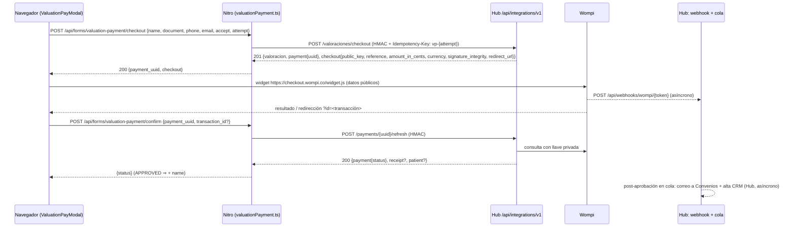

# 06 · Valoraciones y pagos

Contratos del Hub: Hub `docs/api/crediestetica/07-valoraciones-y-pagos.md`. Operación y diagnóstico: Hub `docs/crediestetica/valoraciones-pagos/` (sin confirmar en git).

## 0. Dos flujos distintos (no mezclar)

| Flujo | Qué es | ¿Llega al Hub? |
|---|---|---|
| **Solicitud de valoración («Pide tu cita»)** | `components/forms/ValuationRequest.vue` → `services/ValuationService.ts` → `POST /api/forms/valuation` (Nuxt) → CRM externo (`NUXT_CRM_VALUATION_*`) **o correo SMTP** si falta cualquiera de las 5 variables | **No.** No crea `Valoracion` ni `Client` en Hub |
| **Pago de la valoración** | `components/forms/ValuationPayModal.vue` (usado en `pages/financiacion.vue`) → `POST /api/forms/valuation-payment/{checkout,confirm}` (Nuxt) → Hub `/integrations/v1/*` (HMAC) | **Sí**, solo desde el servidor |

No existe vínculo en base de datos entre una solicitud «Pide tu cita» y un pago.

## 1. Solicitud de valoración

| Elemento | Dato |
|---|---|
| Archivos | `server/utils/valuation.ts` (`handleValuation`, `handleValuationByEmail`), `shared/utils/valuation.ts` (validación), `server/utils/crmDestination` (`shared/utils/crmDestination.ts`: bloquea el destino heredado) |
| Campos | `nombres`, `apellidos`, `identificacion` (`^[A-Za-z0-9]{5,20}$`), `fecha_nacimiento` (`YYYY-MM-DD`), `direccion` (ciudad), `telefono`, `email`, `name_surgery`, `forma_pago`, `accept: true` |
| Estado | CRM propio: **BLOQUEADO** (variables `NUXT_CRM_VALUATION_*` sin definir). Por correo: IMPLEMENTADO (requiere SMTP; destinatarios temporales según el historial) |
| Errores | `422`, `409 duplicate`, `429`, `502/503/504` según CRM/SMTP |
| Pruebas | `tests/security/valuation.test.ts` (ejecutada: CRM y SMTP simulados) |

## 2. Pago de la valoración — flujo completo

### Checkout
| Elemento | Dato |
|---|---|
| Archivos | `components/forms/ValuationPayModal.vue`, `shared/utils/valuationPay.ts` (validación), `server/api/forms/valuation-payment/checkout.post.ts`, `server/utils/valuationPayment.ts` (`handleValuationPayCheckout`) |
| Request (navegador → Nuxt) | `{ name, document, phone, email, accept, attempt }` (`attempt` `^[A-Za-z0-9-]{16,64}$`; se convierte en `Idempotency-Key: vp-{attempt}`; el intento se conserva 30 min en `sessionStorage`) |
| Hacia el Hub | `{ patient: {name, email, phone, document}, return_url }` con firma HMAC; `return_url = {origin}/financiacion` solo si el origen es `https://` (un `http` se omite) y su host debe estar en `linea_domains` activo de la línea o el Hub responde `422` |
| Respuesta al navegador | `200 {payment_uuid, checkout{public_key, reference, amount_in_cents, currency, signature_integrity, redirect_url}}`: solo datos **públicos** |
| Importe | Lo fija el Hub (tarifa de la línea); la web no lo envía. El `price` que recibe `ValuationPayModal` es solo para mostrar |
| Errores mostrados | `403` origen · `422 validation` · `400 malformed` · `429 rate_limited` (5 por 10 min por IP, en memoria) · `409 retry_window`/`conflict` · `503 not_configured` (falta `NUXT_WELLEZY_API_BASE_URL`, `NUXT_HUB_INTEGRATION_KEY_ID` o `_SECRET`) · `503 unavailable` («El pago en línea no está disponible en este momento. Escríbenos por WhatsApp…») |

### Confirmación
| Elemento | Dato |
|---|---|
| Archivos | `server/api/forms/valuation-payment/confirm.post.ts`, `server/utils/valuationPayment.ts` (`handleValuationPayConfirm`) |
| Request | `{ payment_uuid, transaction_id? }` (`transaction_id` `^[A-Za-z0-9._-]{1,100}$`) |
| Respuesta | `{ status: 'PENDING'|'DECLINED'|'VOIDED'|'ERROR' }` o `{ status: 'APPROVED', name }` |
| Qué hace (árbol de trabajo) | **Solo consulta**: llama a `refresh` y devuelve el estado. **No** envía correos, ni PDF, ni registra al cliente en el CRM (lo hace el Hub). En `HEAD` aún lo hacía Nuxt |
| Errores | `400 malformed` · `404` · `502 verify_failed` («No pudimos verificar tu pago… Si ya pagaste, no vuelvas a pagar…») · `429` · `503 not_configured` |
| Regreso desde Wompi | `ValuationPayModal` detecta `?id=<transacción>` y el pago guardado en la pestaña, y llama a `confirm`; la URL por sí sola no prueba nada |

## 3. Qué NO puede asumir esta web

- Que `confirm` con `APPROVED` implique que el correo a Convenios o el alta CRM **ya se hicieron**: son procesos asíncronos del Hub (cola + scheduler), `valoracion_post_approvals` en Hub.
- Que el flujo esté probado con Wompi real: las pruebas usan dobles (`tests/security/valuation-payment.test.ts`, 95/95 con otros 3 archivos, ejecutadas el 2026-11-24). Pago real de Sandbox: una prueba local documentada en el Hub (2026-11-23), sin confirmar webhook vs refresco.
- Que el **Hub desplegado** tenga la post-aprobación y sus migraciones: debe desplegarse antes que esta web.
- Que el mensaje «El pago en línea no está disponible» tenga una causa única: es genérico (Hub o MySQL caídos, migración pendiente, firma `401`, integración sin configurar, línea sin cuenta Wompi/tarifa, `return_url` fuera de `linea_domains`). Diagnóstico: `docs/cambios-importantes/2026-11-23-pago-valoracion-no-disponible-diagnostico.md`.

## 4. Relación con el CRM

| Qué | Dónde | Estado |
|---|---|---|
| Registro del paciente al pagar | Hub: `SyncOmnichannelContactAction` (`Client` + `Lead`) | IMPLEMENTADO · PROBADO (Hub) |
| Alta tras el pago aprobado | Hub: `CrmClientRegistrar` | IMPLEMENTADO sin confirmar; contrato del CRM **BLOQUEADO** (no confirmado) |
| Solicitud «Pide tu cita» | Nuxt → CRM externo o correo | CRM **BLOQUEADO**; correo IMPLEMENTADO |
