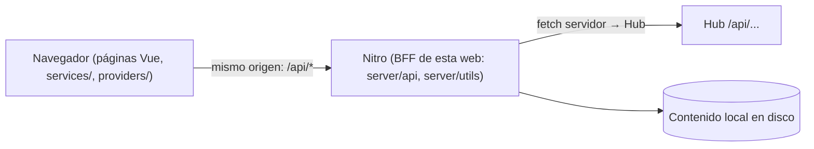

# Integración Crediestética ↔ Wellezy Hub — consumo desde la web

> Auditado el 2026-11-24 contra el árbol de trabajo de este repositorio (rama `integration/crediestetica-prp-migracion`, commit `5c284fd`, con cambios sin confirmar) y de `wellezy-hub-2` (rama `main`, commit `38d8797`, con cambios sin confirmar). Solo documentación. **Nada está verificado como desplegado.**

**El contrato de las APIs es del Hub** y vive en el repositorio `wellezy-hub-2`, directorio `docs/api/crediestetica/` (en adelante «Hub: …»). Aquí se documenta **cómo consume esta web** cada API; no se repiten los contratos completos.

## 1. Niveles de evidencia

`IMPLEMENTADO` (existe en código) · `PROBADO` (hay pruebas verificables) · `CONSUMIDO` (la web lo usa) · `DESPLEGADO` (evidencia en el entorno; **ninguno la tiene**) · `PENDIENTE` · `BLOQUEADO` · `NO VERIFICADO`. No son equivalentes: un endpoint puede estar implementado y probado, pero no consumido ni desplegado.

## 2. Tres capas que no hay que confundir

| Capa | Qué es | Ejemplo |
|---|---|---|
| Navegador | Páginas, `services/*.ts`, `providers/*.ts`; solo llaman a `/api/*` del mismo origen | `publicProcedureService.getProcedures()` |
| **BFF de Nuxt** | Rutas `/api/*` de **esta web** (no son del Hub); validan, aplican CSRF por origen, llaman al Hub y traducen la respuesta | `/api/public/procedures` |
| Hub | `https://<hub>/api/...` | `/api/v1/web/cirugias` |

**Una ruta `/api/*` de esta web no pertenece al Hub.** Devuelve un modelo propio (`ProcedureDto`, etc.), no el JSON del Hub. El navegador nunca llama al Hub.

## 3. Mapa de consumo

Ejecución: **SRV** = servidor Nuxt llama al Hub · **BFF** = el navegador llama a una ruta de Nuxt, que a su vez llama al Hub (todo BFF implica SRV hacia el Hub).

| Funcionalidad | Archivo consumidor | Método | Endpoint Hub (`/api`) | Ejecución |
|---|---|---|---|---|
| Lista de procedimientos | `server/utils/procedures.ts` (`fetchPublicProcedureRows`) vía `server/api/public/procedures/index.get.ts` | GET | `/v1/web/cirugias?page=N` | BFF (SRV) |
| Detalle de procedimiento | `server/api/public/procedures/[slug].get.ts` | GET | `/v1/web/cirugias/{slug}` | BFF (SRV) |
| Categorías | `server/api/public/procedure-categories.get.ts` | GET | `/v1/web/categorias-cirugias` | BFF (SRV) |
| Sitemap de procedimientos | `server/utils/procedureSitemap.ts` (reutiliza `fetchPublicProcedureRows`) | GET | `/v1/web/cirugias?page=N` | SRV |
| Noticias (lista) | `server/api/public/news/index.get.ts` | GET | `/v1/web/posts?per_page=50` | BFF (SRV) |
| Noticias (paginado) | `server/api/public/news-page.get.ts` | GET | `/v1/web/posts?per_page=&page=` | BFF (SRV) |
| Noticia | `server/api/public/news/[slug].get.ts` | GET | `/v1/web/posts/{slug}` | BFF (SRV) |
| Recomendaciones (páginas) | `server/api/public/recommendations/index.get.ts`, `[slug].get.ts` | GET | `/v1/web/recommendation-pages[/{slug}]` | BFF (SRV) |
| Recomendaciones (árbol) | `server/api/public/recommendation-topics/index.get.ts`, `[topic]/[subtopic].get.ts` | GET | `/v1/web/recommendation-topics[/{topic}/{subtopic}]` | BFF (SRV) |
| Nuestros pacientes | `server/api/public/patient-section.get.ts` | GET | `/v1/web/patient-section` | BFF (SRV) |
| Micrositio PRP | `server/api/public/prp/[slug].get.ts` | GET | `/v1/web/prp/{slug}` | BFF (SRV) |
| Resolver referidor PRP | `server/utils/prpReferrer.ts` | GET | `/v1/web/prp/{slug}` (lee `external_code`) | SRV |
| Inscripción PRP | `server/utils/prpEnrollment.ts` | POST | `/v1/web/prp-enrollments` | BFF (SRV) |
| Login del panel | `server/api/auth/login.post.ts` → `wellezyLogin` | POST | `/auth/login` | BFF (SRV) |
| Sesión del panel | `wellezyMe`, `wellezyLogout` | GET/POST | `/auth/me`, `/auth/logout` | BFF (SRV) |
| Cambio de contraseña | `server/utils/passwordChange.ts` | POST | `/auth/password/change` (y re-login) | BFF (SRV) |
| Administración de contenidos | `server/utils/{procedures,news,patients,recommendations,recommendationAdmin,lineUsers,prp}.ts` (`newsSections.ts` y `procedureSections.ts` solo transforman, no llaman al Hub por sí solos: `NO VERIFICADO` si usan otra función) | varios | `/cms/*`, `/prp-referrers*` | BFF (SRV, con Bearer de la sesión) |
| Checkout de valoración | `server/utils/valuationPayment.ts` (`handleValuationPayCheckout`) | POST | `/integrations/v1/valoraciones/checkout` | BFF (SRV, **HMAC**) |
| Confirmación de pago | `server/utils/valuationPayment.ts` (`handleValuationPayConfirm`) | POST | `/integrations/v1/payments/{uuid}/refresh` | BFF (SRV, **HMAC**) |

Rutas de Nuxt **que no llaman al Hub:** `/api/forms/valuation` («Pide tu cita»: CRM externo o correo), `/api/forms/credit-study`, `/api/forms/lead`, `/api/forms/referral` (correo), `/api/public/about`, `/clinics`, `/pages`, `/financing-rate` (contenido local en disco).

### Flujos con diagramas

Procedimientos ([03](03-consumo-de-catalogos.md)) · noticias, recomendaciones, pacientes ([04](04-consumo-de-contenidos.md)) · micrositio e inscripción PRP ([05](05-pacientes-y-prp.md)) · solicitud de valoración, checkout y confirmación ([06](06-valoraciones-y-pagos.md)) · login del panel ([02](02-autenticacion-y-tenancy.md)). No se dibuja como implementado ningún flujo pendiente: el envío de la inscripción PRP al CRM y el alta CRM tras el pago están bloqueados por contratos no confirmados.

## 4. Documentos

| Archivo | Contenido |
|---|---|
| [01-configuracion-y-conexion.md](01-configuracion-y-conexion.md) | URL base, variables, cliente HTTP, timeouts, ambientes |
| [02-autenticacion-y-tenancy.md](02-autenticacion-y-tenancy.md) | Slugs, `X-Tenant-Linea`, sesión del panel, HMAC |
| [03-consumo-de-catalogos.md](03-consumo-de-catalogos.md) | Procedimientos y categorías |
| [04-consumo-de-contenidos.md](04-consumo-de-contenidos.md) | Noticias, recomendaciones, pacientes |
| [05-pacientes-y-prp.md](05-pacientes-y-prp.md) | Nuestros pacientes, pacientes/CRM, PRP |
| [06-valoraciones-y-pagos.md](06-valoraciones-y-pagos.md) | Solicitud de valoración, checkout y confirmación |
| [07-manejo-de-errores.md](07-manejo-de-errores.md) | Errores y estados vacíos |
| [08-matriz-de-integracion.md](08-matriz-de-integracion.md) | Matriz Hub ↔ Crediestética, brechas y riesgos |

Documentación relacionada de este repositorio (no se duplica): `docs/migration/` (decisiones y bloqueos de la migración; varios apartados están obsoletos, ver [08 §5](08-matriz-de-integracion.md#5-documentación-obsoleta-o-que-contradice-el-código)) y `docs/mobile-integration/` (transferencia para la app móvil).

## 5. Estado del código de esta web (git)

| Pieza | Estado |
|---|---|
| Lecturas públicas, PRP, login y CMS | Confirmado en el historial |
| Pago de valoración con Wompi vía Hub (`98154df`, `c8515f2`, …) | Confirmado, **pero el árbol de trabajo lo modifica** |
| `server/utils/valuationPayment.ts`, `components/forms/ValuationPayModal.vue`, `shared/utils/valuationPay.ts`, `nuxt.config.ts` y tests | **Sin confirmar**: el `confirm` pasa a solo consultar y el checkout envía la cédula (`document`) |
| `server/utils/crmClientStore.ts`, `server/utils/receiptPdf.ts` y `tests/security/crm-client-store.test.ts` | **Eliminados sin confirmar** (el correo, el PDF y el alta CRM tras el pago pasan al Hub) |

**Orden de despliegue (conclusión del código):** si se despliega esta web (árbol de trabajo) contra un Hub que no tenga la post-aprobación y sus migraciones, **nadie notifica el pago aprobado**: el Hub debe ir primero.

## 6. Pruebas de esta web (ejecutadas el 2026-11-24)

`node --test` sobre `tests/security/valuation-payment.test.ts`, `tests/security/valuation.test.ts`, `tests/security/prp-referrer-enrollment.test.ts`, `tests/financing/valuation-pay.test.ts`: **95/95 aprobadas** (Hub simulado). Las pruebas de Hub real (`tests/integration/hub-readonly.test.ts`) se omiten sin `NUXT_WELLEZY_API_BASE_URL` y **no se ejecutaron**. No se ejecutaron las pruebas del Hub (MySQL).
