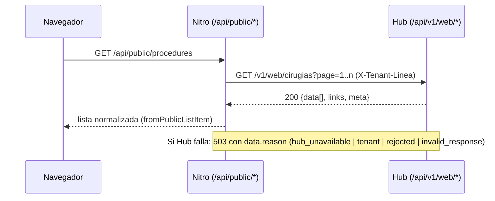

# 01 · Arquitectura actual

## 1. Resumen

Crediestética es una web Nuxt 4 (Vue 3 + Nitro + Tailwind 4). No tiene base de datos propia: delega datos y autenticación en **Wellezy Hub** y guarda en disco el contenido «local» (`NUXT_CONTENT_DIR`, por defecto `./.data/crediestetica-content`).

Fuentes: `package.json`, `nuxt.config.ts`, `README.md`, `server/utils/wellezy.ts`.

## 2. Responsabilidades

| Capa | Responsabilidad | Evidencia |
|---|---|---|
| Navegador (páginas Vue) | UI pública y panel `/admin`; llama solo a `/api/*` del mismo origen | `pages/`, `services/`, `providers/` |
| Nitro `/api/*` (BFF) | Valida, aplica CSRF por origen, llama a Hub con tenant/token/firma, sanea respuestas | `server/api/**`, `server/utils/**` |
| Hub `/api/v1/web/*` | Lectura pública por línea (procedimientos, noticias, recomendaciones, pacientes, PRP) | Hub: `routes/api.php` L221-244 |
| Hub `/api/auth/*`, `/api/cms/*` | Login de personal y administración con Bearer | Hub: `routes/api.php` |
| Hub `/api/integrations/v1/*` | Checkout/consulta de pago de valoración, firma HMAC | Hub: `routes/integrations-api.php` |
| Hub webhook Wompi | Recibe eventos y consulta a Wompi con llave privada | Hub: `WompiWebhookController` |
| Servidor Nuxt (local) | «Nosotros», clínicas, páginas, tasa de financiación, formularios por correo | `server/utils/aboutStore.ts`, `clinics.ts`, `sitePages.ts`, `financingRate.ts`, `formMail.ts` |

## 3. Resolución de empresa y línea

| Mecanismo | Dónde se usa | Detalle |
|---|---|---|
| `X-Tenant-Linea: crediestetica` | Lecturas y escrituras **públicas** a `/v1/web/*` | `wellezyPublicGet/Post` (`server/utils/wellezy.ts`). El valor sale de `runtimeConfig.wellezyLineSlug`; sin valor no se hace la petición. Hub: `ResolveLineaTenant` busca `Linea` activa por slug (o por `X-Tenant-Domain`, que Crediestética **no** envía). |
| `company` + `line` en el cuerpo del login | `POST /auth/login` | `wellezyLogin`: `{email, password, company: 'legalmed', line: 'crediestetica'}`. El token queda con abilities `app:crediestetica`, `company:legalmed`, `line:crediestetica` (Hub: `ApiAccessService::abilitiesFor`). |
| Contexto del token | `/cms/*`, `/auth/me` | Hub: `EnsureApiTokenContext` (`api.context`) deriva empresa/línea de las abilities; el cuerpo no puede cambiarlas. |
| Integración HMAC | `/integrations/v1/*` | La empresa y línea salen de la fila `api_integrations` (clave `X-Hub-Key-Id`), no de la petición. |

Notas verificadas:
- Referencia de ids (solo informativa, **no usada en código**): Legalmed `companies.id=16`, Crediestética `lineas.id=4`, tomados de una copia local de PD (`nuxt.config.ts`, `docs/migration/DECISIONS.md` D-11). No los uses en la app.
- `public.localDomain` (`crediestetica.com`) es informativo: ningún código lo lee.

## 4. Flujo de información

Las rutas públicas de Nuxt devuelven un **modelo propio de la web** (p. ej. `ProcedureDto`), no el JSON de Hub. Una app móvil que quiera el contrato original debe hablar con Hub.

## 5. Servicios propios vs. compartidos

| Servicio | Propiedad | Evidencia |
|---|---|---|
| Procedimientos, categorías | Hub (compartido con Planmed y otras líneas; maestros + propios de línea) | Hub: `CatalogoController` |
| Noticias, recomendaciones, «Nuestros pacientes», PRP | Hub (por línea) | Hub: `routes/api.php` |
| Login de personal y CMS | Hub (compartido) | Hub: `AuthController` |
| Checkout, confirmación de pago, webhook y post-aprobación (correo a Convenios + alta CRM; esta última sin confirmar en git) | Hub (módulo de pagos, por línea; cuenta Wompi por línea). La web solo hace de intermediario del navegador | Hub: `IntegrationValoracionController`, `WompiWebhookController`, `RunValoracionPostApproval` |
| Nosotros, clínicas, páginas, tasa de financiación | **Propio de Crediestética (archivos locales)** | `server/utils/aboutStore.ts`, etc. |
| Formularios: estudio de crédito, solicitud de financiación (`lead`), referidos (correo complementario) | **Propio** (SMTP del servidor Nuxt) | `server/utils/creditStudy.ts`, `leadForm.ts`, `referral.ts` |
| Solicitud de valoración («Pide tu cita») | Propio → CRM médico externo, o correo si el CRM no está configurado | `server/utils/valuation.ts` |
| Inscripción PRP (referidos) | Hub (`/v1/web/prp-enrollments`) | `server/utils/prpEnrollment.ts` |

## 6. Diferencias respecto a Planmed / Cliniplanes

> Aclaración: el repo web documenta como origen **Planmed** (`planmed-web`). El documento de pagos del Hub (`docs/modules/pagos/03-api-y-autenticacion.md` §4) menciona `cliniplanes-web` como repo web verificado. La app móvil «Cliniplanes» **no** forma parte de ninguno de los dos repos auditados; su estructura es `NO VERIFICADO`.

Diferencias comprobadas en el repo web:

| Aspecto | Heredado (Planmed) | Actual (Crediestética) | Evidencia |
|---|---|---|---|
| Línea/empresa | Planmed | `legalmed` / `crediestetica` (slugs) | `nuxt.config.ts` |
| Cookie de sesión | otra | `crediestetica-admin` | `server/utils/auth.ts` |
| CRM de valoración | ids 73/16 del clon | sin valor por defecto; `NUXT_CRM_VALUATION_*` (5 variables) obligatorias, si no → correo | `nuxt.config.ts`, `valuation.ts` |
| Destino CRM heredado (`pdtclientsolutions.com`) | permitido | bloqueado en servidor (`crmDestinationProblem`) | `shared/utils/crmDestination.ts`, `tests/security/crm-destination.test.ts` |
| Destinatarios de correo | Planmed | `convenioscrediestetica@gmail.com` (+ CC diseñadora) | `nuxt.config.ts` |
| Pago de valoración | no existía | Wompi vía Hub con HMAC | commit `98154df` |
| Tasa de financiación | n/a | local, editable por líder/superadmin; sin respaldo si falta (503) | `server/utils/financingRate.ts` |
| Autor de noticias | visible | Hub devuelve `author_name: null` para la línea `crediestetica` | Hub: `PublicPostResource` |
| Identidad corporativa | Planmed | Crediestética (textos legales, branding) | `shared/utils/legalIdentity.ts`, `docs/migration/` |

## 7. Qué es y qué no es contrato móvil

- Contratos estables candidatos: Hub `/api/v1/web/*` (lecturas), `/api/auth/*` (personal).
- No son contrato móvil: `/api/*` de Nuxt (BFF), `/api/integrations/v1/*` (secreto de servidor), `/api/webhooks/wompi/*` (lo llama Wompi).
