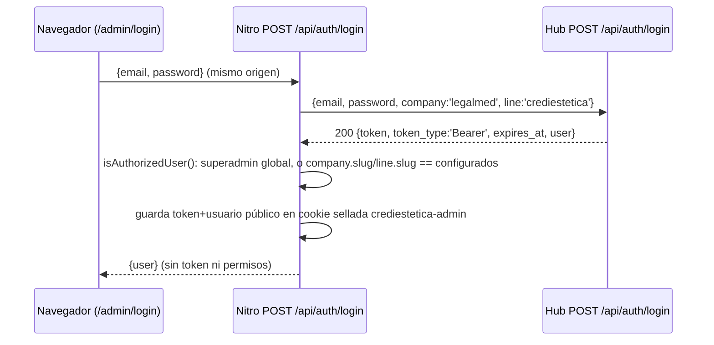

# 03 · Autenticación y tenancy

## 1. Flujo de inicio de sesión (web)



Evidencia: `server/api/auth/login.post.ts`, `server/utils/wellezy.ts` (`wellezyLogin`), `server/utils/auth.ts`.

### Contrato de Hub `POST /api/auth/login`
- Cuerpo (Hub: `ApiLoginRequest`): `email` (req, email), `password` (req), `company` (req, slug), `line` (req, slug).
- Éxito `200`:
```json
{
  "message": "Autenticación exitosa",
  "token": "<plainTextToken Sanctum>",
  "token_type": "Bearer",
  "expires_at": "2026-11-24T20:00:00+00:00",
  "user": {
    "id": 1, "name": "…", "email": "…", "must_change_password": false,
    "company": {"id": 16, "name": "…", "slug": "legalmed"},
    "line": {"id": 4, "name": "…", "slug": "crediestetica"},
    "role": {"id": 20, "name": "…"},
    "is_area_leader": false, "is_global_admin": false,
    "permissions": ["cirugias.ver", "blog.ver"]
  }
}
```
(Estructura: `AuthController::login` + `ApiAuthUserResource`. Los valores del ejemplo son ilustrativos.)
- Errores: `422` validación (Laravel por defecto); `401 {"message":"Las credenciales proporcionadas son incorrectas."}`; `403 {"message":"No tienes acceso a esta aplicación."}` (credenciales válidas pero sin `Personnel` activo en esa empresa/línea y no superadmin); `429` límite.
- Límites (Hub: `AppServiceProvider`, `api-auth-login`): 10/min por IP+correo, 30/min por IP, 20 cada 10 min por cuenta.

## 2. Quién puede iniciar sesión

Hub (`AuthenticateApiUser` + `ApiAccessService::validateAccess`): el usuario necesita un `Personnel` **activo** en la empresa y línea pedidas. Única excepción: superadmin global (`users.is_superadmin`), que entra con contexto virtual. El rol `admin` **no** concede acceso global.

Consecuencia para el móvil: **este login es de colaboradores**. No se encontró en el código auditado ningún login ni cuenta de **paciente/cliente** para Crediestética en Hub (`/portal` y el guard `client` son del portal web de Hub, otro mecanismo, no verificado aquí). Si la app antigua tenía login de pacientes, no tiene equivalente verificado: `NO VERIFICADO` / `PENDIENTE` (ver [08](08-pendientes-y-validaciones.md)).

## 3. Sesiones y tokens

| Aspecto | Web (Nuxt) | Hub |
|---|---|---|
| Almacenamiento | Cookie sellada `crediestetica-admin` (`httpOnly`, `sameSite=lax`, `secure` salvo dev, 8 h) con el token dentro; el navegador nunca lo lee en claro | Token Sanctum personal, nombre `api:legalmed:crediestetica` |
| Caducidad | `SESSION_MAX_AGE = 8 h` | `expires_at` = ahora + `API_AUTH_TOKEN_TTL_MINUTES` (**480 por defecto**, `config/wellezy.php`) |
| Renovación | no | **No existe endpoint de refresh**: solo `login`, `me`, `logout`, `password/change` (`routes/api.php`). Al vencer → volver a iniciar sesión |
| Revocación | `POST /api/auth/logout` llama a Hub y limpia la cookie | `POST /auth/logout` borra **solo** el token actual |
| 401/403 de Hub | `me` limpia la sesión (401/403) | `403 {"message":"No tienes acceso a esta aplicación."}` desde `api.context` |

Requiere `NUXT_SESSION_PASSWORD` ≥ 32 caracteres; si falta, la web responde 503.

## 4. Usuario autenticado y permisos

`GET /auth/me` (Bearer + `api.context`) →
```json
{ "user": { "...mismo recurso que el login..." },
  "token": { "name": "api:legalmed:crediestetica", "abilities": ["app:crediestetica","company:legalmed","line:crediestetica"], "expires_at": "…" } }
```
La web **no** reenvía permisos al navegador: deriva banderas (`toPublicUser`): `canViewProcedures` (`cirugias.ver`), `canViewNews` (`blog.ver`), `canViewPatients` (`pacientes_web.ver`), `canViewRecommendations` (`recomendaciones.ver`), `canViewMicrosites`/`canCreatePrp`/`canEditPrp`/`canDeletePrp` (`prp_referrers.*`), `canEditRate`, `canEditContent`, `canAccessConfiguration`, `mustChangePassword`. Hub impone cada permiso en cada llamada; las banderas son informativas.

Roles: globales (ADR de roles); la web reconoce editores de contenido por **nombre** de rol (`administrador de contenido de línea`, `diseñador gráfico`, `admin`, `superadmin`, `super_admin`) o por `NUXT_CONTENT_EDITOR_ROLE_IDS` (vacío). Los ids de rol varían por entorno: no los fijes en el móvil.

## 5. Recuperación y cambio de contraseña

- **Recuperación («olvidé mi contraseña») por API: no existe** en la superficie de Hub auditada para este login. Hub tiene rutas Fortify del CRM web (`password.email`, `password.update`, limitadas) fuera de la API; no verificadas como contrato móvil.
- **Cambio propio:** `POST /auth/password/change` (Bearer): `current_password`, `password`, `password_confirmation` (política `Password::default()` + `confirmed`, distinta de la actual; Hub: `ApiChangePasswordRequest`). Con `must_change_password=true` solo `me` y este endpoint quedan disponibles; el resto responde `403` (`EnsurePasswordChanged::deniedJson`; la web lo expone como `password_change_required`).
- Límite (`api-auth-password`): 5/min por usuario y 30/min por IP.

## 6. Tenancy: headers y mecanismos

| Mecanismo | Valor | Cuándo |
|---|---|---|
| `X-Tenant-Linea` | `crediestetica` | Todas las rutas `/v1/web/*` |
| `X-Tenant-Domain` | **no se envía** | Hub lo admite (busca `LineaDomain` activo); Crediestética no lo usa; no lo uses en el móvil |
| `company` / `line` en login | `legalmed` / `crediestetica` | Solo `/auth/login` |
| Abilities del token | `app:crediestetica`, `company:legalmed`, `line:crediestetica` | Contexto de `/cms/*` y `/auth/me` |
| `X-Hub-Key-Id` + firma | por integración | `/integrations/v1/*` (servidor) |
| `X-Wellezy-Tenant` | — | Omnicanal; **no aplica** a Crediestética |

Comportamiento de `X-Tenant-Linea` (Hub: `ResolveLineaTenant`): si hay `X-Tenant-Domain` resuelve por dominio; si no, por slug en `lineas` con `activo=true`. Sin resolver → `404 Tenant Linea not found or inactive`. Verificado en vivo contra Hub local (`docs/migration/HUB_READ_VERIFICATION.md`): header correcto → 200; sin header o slug inexistente → 404.

## 7. Restricciones de acceso (web)

- Panel: superadmin global, o usuario cuya `company.slug`/`line.slug` (devueltos por Hub) coincidan con la configuración. Si falta algún dato → denegado (`isAuthorizedUser`).
- Configuración: líder de área (`is_area_leader`) o rol con permiso sobre la tasa.
- Contenido local (Nosotros, clínicas, páginas): superadmin o roles reconocidos.
- Cada acción sensible revalida contra `GET /auth/me` (`requireAreaLeader`, `resolveConfigAccess`).

## 8. Web vs. móvil

| Tema | Web | Móvil (si consumiera Hub directo) |
|---|---|---|
| Dónde vive el token | Servidor (cookie sellada) | Almacén seguro del dispositivo (Keychain/Keystore) — decisión del equipo móvil |
| CSRF/origen | Obligatorio (`assertSameOrigin`) | No aplica a Hub |
| CORS | Hub restringe `api/auth/*` a `wellezy.api_auth.allowed_origins` (`ApplyApiAuthCors`) | No afecta a apps nativas; sí a WebView/híbridas |
| Renovación | Reinicio de sesión a las 8 h / 480 min | Mismo: sin refresh |
| Pacientes | Sin login | Sin contrato verificado |
