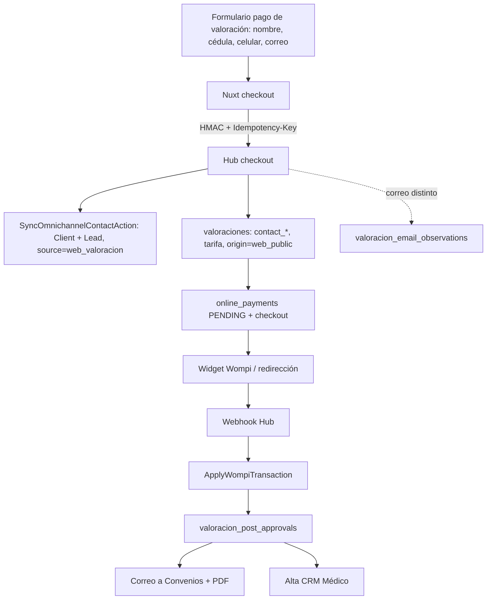

# Nuevas APIs de Crediestética y Wellezy Hub — referencia para el desarrollador móvil

> Auditoría del 2026-11-24 contra el árbol de trabajo de dos repositorios: **Crediestética web** (`C:\Users\pdtco\Desktop\crediestetica`) y **Wellezy Hub** (`C:\xampp\htdocs\laravel\wellezy-hub-2`, rama `main`). Solo lectura: no se cambió código ni configuración.
> **Nada de lo documentado aquí está verificado como desplegado en producción.** La evidencia es código local, pruebas automatizadas con dobles y una prueba manual en Sandbox sobre una copia local de la base (ver §8).

## 0. Cómo leer este documento

- Etiquetas de estado: `IMPLEMENTADA`, `IMPLEMENTADA CON RESTRICCIONES`, `EN DESARROLLO`, `PENDIENTE`, `BLOQUEADA`, `NO VERIFICADA`.
- «Consumible desde móvil» = la app **nativa** podría llamar al endpoint sin secretos de servidor, sin firma HMAC, sin cookie de sesión y sin exigencia de mismo origen. Es una constatación técnica, **no una decisión de producto** ni una aprobación de seguridad.
- Los valores de los ejemplos JSON son ilustrativos; los **nombres de campos, validaciones y estructuras** salen del código citado.
- Para APIs que **no cambiaron** (catálogo base, login de personal), esta carpeta ya las documenta: [02](02-api-contracts.md), [03](03-autenticacion-y-tenancy.md), [04](04-procedimientos-y-catalogos.md). Aquí solo se listan sus deltas (§7).

## 1. Estado del código (qué está confirmado en git)

| Pieza | Estado en git | Consecuencia |
|---|---|---|
| Hub: checkout público HMAC de valoración (`IntegrationValoracionController`, `StartPublicValoracionCheckout`) | **Confirmado** en `main` (merge `4c011da`, commit `a5f1a8e`), pero con **modificaciones sin confirmar** (campo `patient.document`, observación de cambio de correo, validación previa de `return_url`) | El contrato de §3.1 describe el árbol de trabajo, no `HEAD` |
| Hub: post-aprobación (`QueueValoracionPostApproval`, `RunValoracionPostApproval`, `ProcessValoracionPostApproval`, `ReprocessValoracionPostApprovals`, `ValoracionPostApproval`, `ValoracionEmailObservation`, `CrmClientRegistrar`, `ReceiptPdf`, notificación, vistas, 3 migraciones `2026_11_21_*`/`2026_11_23_*`) | **Sin confirmar** (archivos nuevos sin seguimiento) | No existe en `HEAD`; requiere migraciones, worker y scheduler |
| Hub: lectura de pacientes CRMEDIC (`CrmedicClient`, `PatientService`) | `CrmedicClient` confirmado (`3c93ac5`, merge `38d8797`); `PatientService` **sin confirmar** | Servicio interno, sin rutas HTTP (§3.8) |
| Hub: inscripciones PRP (`/v1/web/prp-enrollments`) | Confirmado (`da78eb6`, 2026-11-18) | — |
| Hub: `author_name = null` para la línea `crediestetica` | **Sin confirmar** (`PublicPostResource`) | — |
| Web: `confirm` solo consulta; correo, PDF y alta CRM salen de la web y pasan a Hub; checkout envía `document` | **Sin confirmar** (`server/utils/valuationPayment.ts` modificado; `crmClientStore.ts`, `receiptPdf.ts` eliminados) | `HEAD` de la web aún envía correo/PDF/CRM desde Nuxt y **no** envía cédula |

**Riesgo de despliegue verificado en el código:** si se despliega la web del árbol de trabajo (que ya no envía el correo a Convenios ni hace el alta CRM) contra un Hub que no tenga la post-aprobación y sus migraciones, **nadie notifica el pago aprobado**. El orden correcto sería Hub (migraciones + worker + scheduler + variables) antes que la web. Es una conclusión del código, no una instrucción de despliegue aprobada.

## 2. Resumen de nuevas implementaciones

| Funcionalidad | API | Método | Estado | Consumible desde móvil |
|---|---|---|---|---|
| Crear checkout de valoración (Hub) | `/api/integrations/v1/valoraciones/checkout` | POST | IMPLEMENTADA CON RESTRICCIONES (parte sin confirmar en git; sin prueba contra Wompi real) | **No** (firma HMAC, secreto de servidor) |
| Crear checkout de valoración (web) | `/api/forms/valuation-payment/checkout` | POST | IMPLEMENTADA CON RESTRICCIONES | **No** (solo mismo origen; BFF) |
| Consultar/refrescar estado del pago (Hub) | `/api/integrations/v1/payments/{paymentUuid}/refresh` | POST | IMPLEMENTADA CON RESTRICCIONES | **No** (HMAC) |
| Consultar estado del pago (web) | `/api/forms/valuation-payment/confirm` | POST | IMPLEMENTADA CON RESTRICCIONES | **No** (mismo origen) |
| Webhook de Wompi | `/api/webhooks/wompi/{webhookToken}` | POST | IMPLEMENTADA CON RESTRICCIONES (sin webhook real de Sandbox probado) | **No** (lo llama Wompi) |
| Post-aprobación (correo a Convenios + alta CRM) | proceso interno (job/scheduler), no es API | — | EN DESARROLLO (sin confirmar en git) | No aplica |
| Solicitud de valoración «Pide tu cita» | `/api/forms/valuation` | POST | BLOQUEADA para el CRM propio (variables sin definir); por correo: IMPLEMENTADA CON RESTRICCIONES | **No** (mismo origen); además no llega a Hub |
| Inscripción PRP (Hub) | `/api/v1/web/prp-enrollments` | POST | IMPLEMENTADA CON RESTRICCIONES (envío al CRM: `NullPrpCrmGateway`) | **Técnicamente sí** (el `external_code` lo entrega públicamente `GET /v1/web/prp/{slug}`; ver §3.7) |
| Inscripción PRP (web) | `/api/forms/prp-enrollment` | POST | IMPLEMENTADA | **No** (mismo origen) |
| Lectura de micrositio PRP | `/api/v1/web/prp/{slug}` | GET | IMPLEMENTADA | **Sí** (público) |
| Lectura de pacientes CRMEDIC | ninguna (servicio PHP interno) | — | EN DESARROLLO (interno) | **No existe endpoint** |
| Endpoint público seguro para iniciar valoración/pago desde la app | no existe | — | PENDIENTE | Pendiente de exponer vía capa backend |
| Consulta de estado de pago desde la app | no existe | — | PENDIENTE | Pendiente de exponer vía capa backend |
| Catálogo: bloques de contenido, árbol de recomendaciones, `author_name` | `/api/v1/web/*` | GET | IMPLEMENTADA (ver §7) | **Sí** (público, solo lectura) |
| Valoraciones para asesores (`/api/valoraciones…`) | Bearer + permisos | varios | IMPLEMENTADA (personal, no pacientes) | No para pacientes |

## 3. Contratos

### 3.1 Checkout de valoración — Hub (servidor a servidor)

| Aspecto | Dato |
|---|---|
| Repositorio | Wellezy Hub |
| Ruta | `POST {HUB}/api/integrations/v1/valoraciones/checkout` |
| Implementación | `App\Http\Controllers\Api\Integrations\IntegrationValoracionController::checkout` → `App\Actions\Payments\StartPublicValoracionCheckout::execute` → `StartValoracionCheckout::execute` |
| Registro de rutas | `routes/integrations-api.php`, cargado por `App\Providers\PaymentsServiceProvider` con prefijo `api/integrations/v1` y grupo `api` |
| Middleware | `throttle:integration` (120/min por `X-Hub-Key-Id`+IP), `VerifyIntegrationSignature`, `throttle:integration-checkout` (20/min por defecto) |
| Autenticación | Firma HMAC-SHA256 por integración (`api_integrations`). Empresa y línea salen de la integración, nunca del cuerpo |
| Headers obligatorios | `X-Hub-Key-Id`, `X-Hub-Timestamp` (UNIX, ±300 s), `X-Hub-Nonce` (único, ≤100; se rechaza si se repite 10 min), `X-Hub-Signature`, `Idempotency-Key` (`^[A-Za-z0-9._-]{8,100}$`), `Content-Type: application/json` |
| Firma | `HMAC-SHA256(secreto, "POST\n/api/integrations/v1/valoraciones/checkout\n<timestamp>\n<nonce>\n<sha256(cuerpo exacto)>")`, hex minúsculas |
| Parámetros de ruta/query | ninguno |

**Request** (validación `IntegrationValoracionController::checkout`):
```json
{
  "patient": { "name": "Ana Pérez", "email": "ana@example.com", "phone": "3001234567", "document": "1012345678" },
  "return_url": "https://crediestetica.com/financiacion"
}
```
- `patient.name` req. 2–100 · `patient.email` req. `email:rfc` ≤150 (se guarda en minúsculas) · `patient.phone` req. ≤20, `^[+\d\s()-]+$` · `patient.document` opcional, `^\d{5,12}$` · `return_url` opcional ≤500.
- `return_url`: debe ser `https` (o `http` solo en `local`/`testing`) y su host debe coincidir con un `linea_domains` activo de la línea; si no, `422` con `errors.redirect_url`.
- Cualquier `amount`, línea, empresa o cuenta Wompi enviados **se ignoran**.

**Respuesta `201`** (`checkout`):
```json
{
  "valoracion": { "uuid": "…", "status": "registered", "payment_status": "unpaid", "amount_cents": 15000000, "currency": "COP" },
  "payment":    { "uuid": "…", "status": "PENDING" },
  "checkout":   { "public_key": "pub_…", "reference": "VAL-…", "amount_in_cents": 15000000, "currency": "COP",
                  "signature_integrity": "<sha256>", "redirect_url": null }
}
```
(`checkout` = `StartValoracionCheckout`: llave pública, referencia, importe de la **tarifa vigente de la línea**, moneda, `sha256(reference + amount + currency + integrity_secret)`, `redirect_url`. Nunca llaves privadas ni secretos.)

**Errores**

| HTTP | Cuerpo | Causa |
|---|---|---|
| 401 | `{"message":"No autorizado."}` | firma/clave/timestamp/nonce inválidos (mensaje genérico) |
| 422 | `{"message","errors":{campo:[…]}}` (mensajes en español) | validación; o `{"message":"Falta una clave de idempotencia válida."}`; o `errors['patient.email']` = «No pudimos registrar este correo. Escríbenos por WhatsApp para ayudarte.» (conflicto de identidad del correo con otra empresa) |
| 409 | `{"message"}` | misma `Idempotency-Key` con otros datos; valoración ya pagada |
| 409 | `{"message","code":"retry_window_active","retry_after_seconds"}` + `Retry-After` | intento anterior aún reintentable en Wompi (ventana por defecto 180 s, `WOMPI_RETRY_WINDOW_SECONDS`) |
| 503 | `{"message":"El pago en línea no está disponible en este momento."}` | línea inactiva, sin cuenta Wompi activa, sin tarifa (el detalle va solo al log del Hub) |
| 429 | — | límites |

**Reglas de negocio**
1. Importe = tarifa sugerida vigente de la línea (`valoracion_tarifas`); sin tarifa → 503 y no se crea nada.
2. Antes de registrar nada se valida: línea activa, exactamente una cuenta Wompi activa, `return_url`.
3. El paciente se sincroniza como `Client`/`Lead` con `SyncOmnichannelContactAction` (`source = web_valoracion`, `linea_id`); identidad por teléfono/correo dentro de la empresa. La acción **no se modificó**.
4. La valoración guarda lo que el paciente informó en `contact_name/email/phone/document`; el `Client` maestro **no se sobrescribe**.
5. Si el correo informado difiere del correo del cliente existente, se crea una `ValoracionEmailObservation` (`pending_verification`) y el checkout continúa con el correo informado.
6. Idempotencia: `Idempotency-Key` + huella `sha256(patient, return_url)` en caché 24 h; repetir devuelve la misma valoración y reutiliza el intento abierto.
7. `price_snapshot`, `amount_cents`, `currency`, `suggested_amount_cents` son inmutables.

**Restricciones para móvil:** requiere el secreto de la integración. **La app no debe contenerlo ni firmar.** Un backend propio podría firmar (reutiliza este contrato) o Hub tendría que exponer otro; ambos son decisiones pendientes (§6).

### 3.2 Checkout de valoración — Nuxt (BFF del navegador)

| Aspecto | Dato |
|---|---|
| Ruta | `POST https://crediestetica.com/api/forms/valuation-payment/checkout` |
| Implementación | `server/api/forms/valuation-payment/checkout.post.ts` → `handleValuationPayCheckout` (`server/utils/valuationPayment.ts`); validación `shared/utils/valuationPay.ts` |
| Middleware/guardas | `assertSameOrigin` (403 `Origen no permitido` sin Origin/Sec-Fetch-Site/Referer del mismo host); `Cache-Control: no-store`; límite en memoria 5 por 10 min por IP (`formMail.ts`) |
| Autenticación | Ninguna del usuario; el servidor firma hacia Hub con `NUXT_HUB_INTEGRATION_KEY_ID`/`_SECRET` |
| Headers | `Content-Type: application/json` + (navegador) `Origin` |

**Request**
```json
{ "name": "Ana Pérez", "document": "1012345678", "phone": "3001234567", "email": "ana@example.com",
  "accept": true, "attempt": "3f2a9c1e-5b7d-4c8a-9e10-a1b2c3d4e5f6" }
```
`name` 2–100 · `document` 5–12 dígitos · `phone` 7–15 dígitos (`^[+\d\s()-]+$`) · `email` ≤150 · `accept` exactamente `true` · `attempt` `^[A-Za-z0-9-]{16,64}$` (se convierte en `Idempotency-Key: vp-{attempt}`; el cliente web la conserva 30 min en `sessionStorage`). `return_url` solo se envía a Hub si el origen es `https://` (`{origin}/financiacion`).

**Respuesta `200`:** `{ "payment_uuid": "…", "checkout": { "public_key", "reference", "amount_in_cents", "currency", "signature_integrity", "redirect_url" } }`

**Errores:** `403` origen · `422` `{message, reason:"validation", errors}` · `400 reason:"malformed"` (attempt) · `429 rate_limited` · `409 retry_window` / `conflict` · `503 reason:"not_configured"` (falta `NUXT_WELLEZY_API_BASE_URL`, `NUXT_HUB_INTEGRATION_KEY_ID` o `_SECRET`) · `503 reason:"unavailable"` («El pago en línea no está disponible en este momento. Escríbenos por WhatsApp y una asesora te ayudará.»; mensaje genérico, causas en [§3.5](#35-diagnóstico-del-mensaje-genérico)).

**Restricciones para móvil:** no consumible (mismo origen + sin contrato). Una app que lo llamara recibiría `403`.

### 3.3 Consulta/actualización del estado del pago

**Hub — `POST {HUB}/api/integrations/v1/payments/{paymentUuid}/refresh`**

| Aspecto | Dato |
|---|---|
| Implementación | `IntegrationValoracionController::refresh` → `WompiClient::fetchTransaction` → `ApplyWompiTransaction::execute` |
| Middleware | `throttle:integration`, `VerifyIntegrationSignature`; `{paymentUuid}` con `whereUuid` |
| Autenticación | HMAC (igual que §3.1; **sin** `Idempotency-Key` obligatoria) |
| Request | `{ "transaction_id": "<id Wompi, opcional, ≤100>" }`; si falta usa `provider_transaction_id` del pago |
| Alcance | solo pagos de `Valoracion` de la empresa/línea de la integración; otro → `404` |

**Respuesta `200`:**
```json
{ "payment": { "uuid": "…", "status": "APPROVED" },
  "receipt": { "concept": "Valoración", "reference": "VAL-…", "transaction_id": "…", "amount_cents": 15000000, "currency": "COP", "paid_at": "2026-11-24T10:00:00-05:00" },
  "patient": { "name": "…", "email": "…", "phone": "…" } }
```
`receipt` y `patient` solo con `APPROVED`. Sin `transaction_id` conocido devuelve solo `payment`.
**Errores:** `401` firma · `404` pago inexistente/otra línea · `422 {"message":"La transacción no corresponde a este pago."}` (referencia, importe o moneda distintos, o estado Wompi desconocido) · `502 {"message":"No se pudo verificar el pago con Wompi. Intente de nuevo."}`.
**Regla:** consulta la transacción con la **llave privada** de la cuenta; la redirección del navegador nunca aprueba un pago. Si queda aprobada, `ApplyWompiTransaction` encola la post-aprobación (§3.4).

**Nuxt — `POST /api/forms/valuation-payment/confirm`** (`handleValuationPayConfirm`): mismas guardas que §3.2; request `{ "payment_uuid": "<uuid>", "transaction_id": "<opcional ^[A-Za-z0-9._-]{1,100}$>" }`; respuesta `{ "status": "PENDING|DECLINED|VOIDED|ERROR" }` o `{ "status": "APPROVED", "name": "…" }`. Errores: `400 malformed`, `404` o `502 reason:"verify_failed"` (mensaje: «No pudimos verificar tu pago en este momento. Si ya pagaste, no vuelvas a pagar…»), `429`, `503 not_configured`. En el árbol de trabajo **solo consulta**: no envía correos ni registra al cliente.

**Restricciones para móvil:** ninguno de los dos es consumible por la app (HMAC / mismo origen). **No existe un endpoint para que el paciente consulte el estado de su pago desde la app**; solo el `status` que Wompi devuelve al widget. Capacidad `PENDIENTE` de exponer mediante una capa backend apropiada (§6).

### 3.4 Webhook de Wompi y post-aprobación

| Aspecto | Dato |
|---|---|
| Ruta | `POST {HUB}/api/webhooks/wompi/{webhookToken}` (`routes/payments-api.php`, grupo `api`, `throttle:120,1`) |
| Implementación | `App\Http\Controllers\Webhooks\WompiWebhookController::__invoke` → `WompiWebhookVerifier::isValid` → job `ProcessWompiEvent` (cola `bmq-issuance`, constante añadida en un cambio sin confirmar; el worker debe escuchar esa cola) |
| Autenticación | checksum del evento con el `events_secret` de la cuenta Wompi (no hay Bearer ni HMAC de integración) |
| Headers | `X-Event-Checksum` (opcional; si viene, debe coincidir) |

**Validación de firma:** `sha256( concat(valores de data según signature.properties) + timestamp + events_secret )` comparado en tiempo constante con `signature.checksum`; cada propiedad debe cumplir `^[a-zA-Z0-9_.]+$` y ser escalar.

**Respuestas:** token desconocido → `200 {"received":true}` (sin pistas); checksum inválido → `401 {"message":"Firma no válida."}`; `environment` distinto del de la cuenta (`prod`/`test`) o evento distinto de `transaction.updated` → `200` sin procesar; resto → guarda `online_payment_events` (único por `checksum_hash` y cuenta) y encola. La cuenta de la URL debe ser la del pago (si no, queda como huérfano).
**El evento nunca aprueba un pago:** el job consulta la transacción a Wompi con la llave privada y la aplica con las mismas comprobaciones de referencia, importe y moneda.

**Estados** (`OnlinePaymentStatus`): `PENDING`, `APPROVED`, `DECLINED`, `VOIDED`, `ERROR` (Wompi desconocido → rechazo). Transiciones: `PENDING`→cualquiera; `APPROVED`→`VOIDED`; el resto terminal. `EXPIRED` no existe. Resumen en la valoración (`syncValoracion`): `APPROVED`→`paid`; si no, `PENDING`→`pending`; `VOIDED`→`refunded`; si no `unpaid`.

**Qué ocurre tras aprobarse** (`ApplyWompiTransaction` → `QueueValoracionPostApproval` → `ProcessValoracionPostApproval` → `RunValoracionPostApproval`; **sin confirmar en git**):
1. Solo si `VALORACION_POST_APPROVAL_LINEA_ID` coincide con la línea del pago y `valoracion.origin = web_public`; sin la variable no hace nada.
2. Se crea una fila `valoracion_post_approvals` por pago (única) y se encola el job tras confirmar la transacción.
3. **Correo interno** a `VALORACION_POST_APPROVAL_MAIL_TO` (defecto `convenioscrediestetica@gmail.com`) con comprobante PDF y, si hay observación pendiente, la advertencia de cambio de correo.
4. **Alta en el CRM Médico** (`CrmClientRegistrar`): `POST CRM_CLIENT_URL` con `name`, `phone` (con prefijo 57 si es celular de 10 dígitos), `identificacion` (si hay), `ad_headline: "formulario web"`, `advisor_email`, `id_line`. Resultados `sent | failed | unknown | skipped`; `unknown` nunca se reenvía. **El contrato de respuesta del CRM no está confirmado** (criterio de éxito provisional).
5. Cada acción tiene estado propio e idempotente; un fallo no revierte el pago. `valoraciones:reprocess-post-approvals` (cada 10 min) reencola solo lo reintentable. Requiere worker de colas y scheduler.

**Qué queda almacenado en Hub** (columnas en `docs/crediestetica/valoraciones-pagos/08-modelo-de-datos.md` del Hub): `valoraciones` (incl. `contact_*`, `price_snapshot`, `origin`, `payment_status`, `paid_at`), `online_payments`, `online_payment_transactions` (incl. `payment_method_type`), `online_payment_events` (payload reducido: sin firma ni datos de pago), `valoracion_email_observations`, `valoracion_post_approvals`, `clients`/`leads`, bitácora `AuditLogger`.

**Restricciones para móvil:** ninguna acción; no es una API de la app.

#### 3.5 Diagnóstico del mensaje genérico

«El pago en línea no está disponible» cubre: Hub o MySQL caídos, migraciones sin aplicar, firma `401`, integración sin configurar, línea sin cuenta Wompi/tarifa, `return_url` fuera de `linea_domains` (422 del Hub se muestra tal cual). Lista de comprobación: Hub `docs/cambios-importantes/2026-11-23-pago-valoracion-no-disponible-diagnostico.md` y `docs/crediestetica/valoraciones-pagos/11-diagnostico-y-recuperacion.md`.

### 3.6 Relación valoración ↔ paciente ↔ solicitud ↔ pago



- **Solicitud de valoración «Pide tu cita»** (`POST /api/forms/valuation`) es un flujo **distinto**: no crea `Valoracion` ni `Client` en Hub. Va a un CRM externo (`NUXT_CRM_VALUATION_URL`, `multipart`, timeout 15 s) o, si falta cualquiera de las 5 variables `NUXT_CRM_VALUATION_*`/destino válido, por **correo SMTP** (canal principal); con CRM confirmado el correo es complementario. Validaciones: `shared/utils/valuation.ts` (`nombres`, `apellidos`, `identificacion` `^[A-Za-z0-9]{5,20}$`, `fecha_nacimiento` `YYYY-MM-DD`, `direccion` (ciudad), `telefono`, `email`, `name_surgery`, `forma_pago`, `accept: true`). Errores `422/409 duplicate/429/502/503/504`. Estado: CRM propio `BLOQUEADA`; por correo `IMPLEMENTADA CON RESTRICCIONES` (requiere SMTP). **No hay vínculo en base entre esta solicitud y un pago**; la única asociación solicitud↔paciente↔pago existe dentro del checkout de pago (misma `Valoracion` y `Client`).
- Identificación del paciente: Hub identifica por teléfono (y luego correo) dentro de la empresa; la cédula se guarda en `valoraciones.contact_document` y se usa para el alta CRM, **no** para resolver el `Client` en este flujo (`StartPublicValoracionCheckout::existingClient` replica el orden de la acción: teléfono, luego correo).
- No existe login ni cuenta de paciente en este flujo.

### 3.7 Inscripción al programa de referidos (PRP)

**Hub — `POST {HUB}/api/v1/web/prp-enrollments`**

| Aspecto | Dato |
|---|---|
| Implementación | `App\Http\Controllers\Api\Web\PrpEnrollmentController::store` → `RegisterPrpEnrollment` → `LinkPrpEnrollmentClient` + `ProcessPrpEnrollmentCrm` |
| Middleware | `throttle:60,1`, `linea.tenant`, `throttle:prp-enrollment` (10/min por IP) |
| Autenticación | ninguna; tenant por `X-Tenant-Linea` |
| Headers | `X-Tenant-Linea: crediestetica`, `Idempotency-Key` (`^[A-Za-z0-9_-]{16,64}$`), `Content-Type: application/json` |

**Request** (`StorePrpEnrollmentRequest`): `external_code` (req., ≤50, sin espacios) · `full_name` 3–150 · `phone` (7–15 dígitos) · `email?` · `document_type` ∈ `CÉDULA DE CIUDADANÍA | TARJETA DE IDENTIDAD | CÉDULA DE EXTRANJERÍA | PASAPORTE | NIT | OTRO` · `document_number` `^[A-Z0-9-]{5,20}$` · `surgery_date` `Y-m-d` (≤ hoy, > 1990-01-01) · `surgery_name` 2–150 · `wants_control` bool · `payment_method` ∈ `efectivo | transferencia` (con `transferencia` exige `bank_holder_name`, `bank_holder_document`, `bank_account_number`; con `efectivo` están prohibidos) · `suggestion?` ≤1000 · `accepted_contract` `accepted`.
**Respuesta `201`:** `{ "data": { "uuid": "…", "status": "completed|received" } }` (`completed` solo si el CRM confirmó; hoy el gateway enlazado por defecto es `NullPrpCrmGateway`, que no envía: sin contrato de CRM confirmado). **Errores:** `422`; `409 {"message":"La clave de idempotencia ya se utilizó con otros datos."}`; `404` tenant.
**Reglas:** el cliente se crea/asocia de forma inequívoca sin sobrescribir datos existentes; coincidencias dudosas quedan pendientes de revisión; los datos bancarios se guardan cifrados; `contract_accepted_at = now()`; idempotencia por línea (hash sin datos en claro).

**Nuxt — `POST /api/forms/prp-enrollment`** (`server/utils/prpEnrollment.ts`): mismo origen; límite 6/10 min por IP; resuelve `external_code` con el slug del micrositio (`prpReferrer.ts`); clave de idempotencia derivada con HMAC de `NUXT_SESSION_PASSWORD`; éxito `{ "ok": true, "status": "completed|received" }`; después envía un correo complementario (`referral.ts`).

**Móvil:** el endpoint de Hub es público y sin secretos, pero requiere `external_code`. **Corrección (2026-11-24):** una versión anterior de este documento decía que la app no podía obtenerlo; es incorrecto. `GET /v1/web/prp/{slug}` (`PublicPrpReferrerResource`) **devuelve `external_code` públicamente** y la prueba `PrpReferrerTest` lo exige. La web de Crediestética lo usa solo en el servidor y lo oculta al navegador, pero esa es una decisión del consumidor, no del Hub. Que la app lo obtenga y envíe es técnicamente posible; exponer ese código a clientes es una **decisión de negocio/seguridad pendiente**, y el envío al CRM sigue bloqueado (`NullPrpCrmGateway`).

### 3.8 Pacientes y CRMEDIC

`App\Services\Crmedic\CrmedicClient` (solo lectura, `X-API-Key`, sin reintentos ni redirecciones) y `App\Services\Patients\PatientService` (`findById`, `findByDocument`, `search`; caché cifrada y de poca duración en el almacén `patients`) son **servicios PHP internos del Hub**. **No existe ninguna ruta HTTP que los exponga** (búsqueda en `routes/*.php`: las rutas `patients` encontradas pertenecen a BMQ, otro dominio) y la web no los usa. `search` devuelve candidatos, nunca identidades confirmadas. No se verificó si el «CRM Médico» del alta de §3.4 y CRMEDIC son el mismo sistema (`NO VERIFICADA`). Estado: `EN DESARROLLO`; sin API para móvil.

## 4. Clasificación obligatoria

| Clase | APIs | ¿Puede consumirla la app directamente? |
|---|---|---|
| 1. Públicas de Hub | `GET /v1/web/*` (§7, [02](02-api-contracts.md)); `POST /v1/web/prp-enrollments` | Lecturas: **sí** (header `X-Tenant-Linea`). Escritura PRP: técnicamente sí (el `external_code` es público en `GET /v1/web/prp/{slug}`); decisión de producto pendiente. Que sean públicas **no** las hace adecuadas para operaciones sensibles |
| 2. Autenticadas de Hub | `/auth/*`; `/cms/*`; `/prp-referrers*`; `/valoraciones*` (asesores) | Con Bearer de **personal** (`Personnel`); no son para pacientes. `/valoraciones*` exige permisos (`valoraciones.*`, `pagos_online.*`) |
| 3. Internas de Crediestética/Nuxt | `/api/public/*`, `/api/forms/*`, `/api/auth/*`, `/api/admin/*` | **No**: BFF del navegador (mismo origen para mutaciones, cookie de sesión `httpOnly`) |
| 4. Servidor a servidor | `/api/integrations/v1/*` | **No**: exigen secreto HMAC |
| 5. Webhooks externos | `/api/webhooks/wompi/{token}` | **No**: lo invoca Wompi |
| 6. Sin contrato móvil | iniciar valoración/pago, consultar estado de pago, decisión de producto sobre inscripción PRP desde la app, tasa de financiación, Nosotros/clínicas/páginas, pacientes CRMEDIC | Pendiente de definir (§6) |

## 5. Verificación técnica y pruebas

Comprobado en código (rutas, método, middleware, controlador, validación y respuesta) para cada endpoint de §3. Cobertura de pruebas existente (leída; las del Hub **no se ejecutaron** porque requieren MySQL y la regla del proyecto lo limita a petición expresa):

| API | Prueba | Tipo | Resultado conocido |
|---|---|---|---|
| Checkout/refresh Hub | `tests/Feature/Payments/IntegrationValoracionCheckoutTest.php` (19 casos) | Pest con MySQL de pruebas; Wompi simulado | 19/19 según la documentación del Hub (no re-ejecutado aquí) |
| Post-aprobación | `tests/Feature/Payments/ValoracionPostApprovalTest.php` (15 casos) | Pest; `Http::fake` para CRM, SMTP simulado | idem |
| Webhook / reintento | `WompiRetryAndReconciliationTest.php`, `ValoracionPaymentEngineTest.php` | Pest; checksum calculado por el propio test | idem |
| Migración `payment_method_type` | `PaymentMethodTypeColumnMigrationTest.php` | Pest | idem |
| Inscripción PRP | `tests/Feature/Api/PrpEnrollmentTest.php` (49 casos) | Pest | no re-ejecutado |
| Lectura de pacientes | `tests/Unit/Patients/PatientServiceTest.php` | unitaria | no re-ejecutado |
| Web: checkout, confirm | `tests/security/valuation-payment.test.ts`, `tests/financing/valuation-pay.test.ts` | `node --test`, Hub simulado | **Ejecutadas hoy: 95/95 aprobadas** (junto con `valuation.test.ts` y `prp-referrer-enrollment.test.ts`; comando `node --test` sobre esos 4 archivos) |
| Web: solicitud de valoración | `tests/security/valuation.test.ts` | `node --test`, CRM y SMTP simulados | incluida en las 95 |

**Wompi:** no hay evidencia de pruebas contra Wompi de producción. La documentación del Hub registra un pago de Sandbox aprobado en una copia local (2026-11-23) sin confirmar si llegó por webhook o por refresco, con `MAIL_MAILER=log` y CRM `skipped`. Pendientes de validación real: webhook de Sandbox a URL pública, caso «paciente cierra el navegador», SMTP real, contrato del CRM.

## 6. Decisiones pendientes y capacidades por exponer

- **Iniciar valoración/pago desde la app:** no existe endpoint público seguro. Habría que definir, tras comprobar si basta lo existente: (a) backend propio que firme HMAC con el contrato §3.1, o (b) un contrato público nuevo en Hub; cómo se abre Wompi en nativo (SDK/enlace) con `public_key`, `reference`, `amount_in_cents`, `currency`, `signature_integrity`; qué `return_url` usar (solo `https` en dominios de `linea_domains`; un esquema profundo hoy daría `422`).
- **Consultar estado del pago:** equivalente de §3.3 sin HMAC en la app.
- **PRP desde la app:** `GET /v1/web/prp/{slug}` ya expone el `external_code`; decidir si eso es aceptable o si debe protegerse en el Hub.
- **Solicitud «Pide tu cita» desde la app:** hoy solo BFF.
- **Hub:** confirmar en git y desplegar la post-aprobación y sus migraciones antes de la web; contrato real del CRM.
- No se propone modificar Hub ni Crediestética en esta tarea.

## 7. APIs públicas de catálogo: qué cambió

Contratos base (sin cambios): [02](02-api-contracts.md) §A y [04](04-procedimientos-y-catalogos.md). Cambios identificados en el historial de Hub (`git log` sobre `routes/api.php`, `app/Http/Resources/Web`, `app/Http/Controllers/Api/Web`):

| Cambio | Evidencia | Estado | Qué debe revisar el móvil |
|---|---|---|---|
| Bloques de contenido por columna en secciones de noticias, procedimientos y recomendaciones (`secciones[].blocks{main,left,right}`, `column_layout`; tipos `text`, `image`, `youtube`, `instagram`) | commits `cc38304`, `b8ef2d3`, `b945dc1` (2026-10-22); `PostSectionBlocks::publicBlocks` | IMPLEMENTADA (en `HEAD`) | Soportar bloques; mantener lectura del formato anterior (`content`, `content_left/right`) si Hub no trae `blocks` |
| Árbol de recomendaciones `recommendation-topics` (tema → subtemas → secciones → ítems; subtema con `short_url`) | `routes/api.php` (grupo `v1/web`); contrato en `shared/utils/recommendationTree.ts` | IMPLEMENTADA | `recommendation-pages` conserva su contrato histórico; no usar `path` (depende de la línea), construir rutas con slugs |
| Recomendaciones por procedimiento con fuente efectiva (`recomendaciones.{cuidados,revision}.fuente`) y endpoint `cirugias/{slug}/recomendaciones/{tipo}` | `CatalogoController`, `CirugiaListResource` | IMPLEMENTADA (el endpoint de detalle por tipo `NO VERIFICADA` en cuanto a campos: la web no lo consume) | Respetar `fuente` |
| `author_name` = `null` en la línea `crediestetica` | `PublicPostResource` (diff sin confirmar) | **EN DESARROLLO** (sin confirmar) | No depender de autor |
| `patient-section` con `visibility` y `referral` | `PatientSectionController` | IMPLEMENTADA | Respetar `visibility.videos/before_after` |
| Micrositio PRP público `GET /v1/web/prp/{slug}` | `PublicPrpController`; `da78eb6` | IMPLEMENTADA | Solo `name`, `slug`, `title` son útiles a la web |
| Paginación de procedimientos: 15 fijo, `?categoria=` | `CatalogoController::cirugias` | IMPLEMENTADA | Recorrer todas las páginas |

Disponibilidad de datos publicados por línea en el entorno real: `NO VERIFICADA` (la copia auditada devolvía listas vacías).

## 8. Documentación anterior que quedó obsoleta o contradice el código

| Documento | Afirmación | Realidad verificada | Acción |
|---|---|---|---|
| Hub `docs/modules/pagos/03-api-y-autenticacion.md` (cabecera) | «No existen la superficie HMAC… ni `Idempotency-Key`» | Existen (`routes/integrations-api.php`, `VerifyIntegrationSignature`, `IntegrationValoracionController`) | Obsoleto; no se editó |
| Mismo doc §5.1 | Cuerpo con `patient{document_type, document_number, …}`, `consent`, `interest_cirugia_ids`, `GET /valoraciones/{uuid}`, `payment-links`; salida con `expiration_time` | El cuerpo real es `patient{name,email,phone,document?}` + `return_url`; solo existen `POST valoraciones/checkout` y `POST payments/{uuid}/refresh`; el checkout devuelve 6 campos | Propuesta de diseño no implementada |
| Hub `docs/crediestetica/valoraciones-pagos/12` | Rama `feat/integracion-pacientes-crm-medico` | La rama actual es `main` (merge `4c011da`); la post-aprobación sigue sin confirmar | Corregir la rama al actualizar ese doc |
| Web `docs/migration/INTEGRATION_BLOCKERS.md` B-04 y `KNOWN_ISSUES.md` KI-08 | «No se pudo comprobar si Hub guarda `accepted_contract` ni el endpoint» | Existe `/v1/web/prp-enrollments` (`da78eb6`); valida `accepted_contract` y guarda `contract_accepted_at` | Obsoleto |
| Web `docs/migration/KNOWN_ISSUES.md` KI-03, `FUNCTIONAL_PARITY.md`, `HUB_READ_VERIFICATION.md` (PRP) | Micrositios PRP bloqueados por destino CRM heredado | `/api/public/prp/[slug]` ya no depende del CRM y el micrositio usa `ReferralForm` → Hub (`pages/prp/[slug].vue`); `PrpLeadForm`/`crmPrpFormUrl` sin uso en páginas | Obsoleto para el micrositio; verificar `PrpLeadForm` |
| Web `docs/migration/INFORME_AVANCE_FUNCIONAL.md`, `FUNCTIONAL_PARITY.md` | Solicitud de valoración «bloqueada, 503» | Con CRM no configurado el **correo** es el canal principal (`handleValuationByEmail`); 503 solo sin CRM ni SMTP | Parcialmente obsoleto |
| Web `docs/migration/*` | No describen el pago de valoración con Wompi (commit `98154df`, posterior) | Ver §3 | Documento nuevo es este |
| Mi versión anterior `05-valoraciones-y-pagos.md` | Integrada aquí | Se **retiró** para no duplicar | Ver [README](README.md) |
| Mi versión anterior de `01` §5 y `08` F-13 | Post-aprobación en la web / `PARCIAL` | En el árbol de trabajo la hace Hub; sigue sin confirmar | Actualizado |

## 9. Qué debe revisar el desarrollador en el repositorio móvil

La app antigua no está disponible: **no se afirma qué usa**. Buscar y reportar:
- URLs base y variantes de ambiente; cualquier dominio de Cliniplanes/Planmed.
- Headers de tenant (`X-Tenant-*`), ids de empresa/línea, `company_id`/`linea_id`.
- Login: ¿para pacientes o personal? ¿qué endpoint? ¿manejo de expiración y de `must_change_password`?
- Rutas de procedimientos, categorías, noticias, recomendaciones (¿campos en inglés del modelo de la web o en español de Hub?).
- Envío de solicitudes de valoración (¿directo a un CRM? ¿con qué ids?).
- Integración de pagos: ¿usa Wompi con llaves en la app? ¿widget web embebido? (no debe haber llaves privadas ni secretos HMAC).
- Búsquedas: `planmed`, `cliniplanes`, `X-Tenant`, `pdtclientsolutions`, `crm-public`, `wompi`, `private_key`, `integrity`, `HMAC`.
