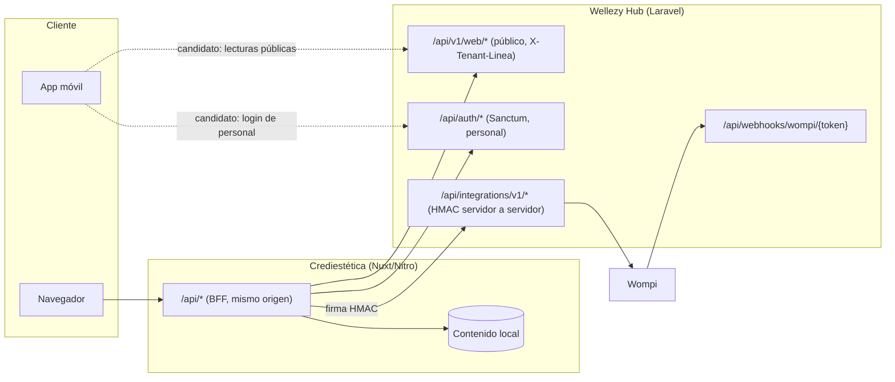

# Integración móvil de Crediestética — documentación de transferencia

> Fecha de la auditoría: 2026-11-24 (segunda revisión: nuevas APIs). Solo documentación: no se modificó código, rutas, configuración, variables de entorno, base de datos ni integraciones.

## 1. Propósito y límite

Esta carpeta dice al desarrollador de la app móvil **qué contratos existen hoy** en Crediestética (web) y Wellezy Hub, cuáles puede consumir y cuáles no. El repositorio de la app móvil **no se revisó**: todo lo que se dice de la implementación antigua es `NO VERIFICADO`.

| Repositorio | Ruta local auditada | Rol |
|---|---|---|
| Crediestética web | `C:\Users\pdtco\Desktop\crediestetica` | Nuxt 4 / Nitro (sitio público + panel, BFF del navegador) |
| Wellezy Hub | `C:\xampp\htdocs\laravel\wellezy-hub-2` | Laravel 13, backend compartido (solo lectura en esta tarea) |

**Aviso de estado del código:** en ambos repos hay cambios sin confirmar en git. La documentación describe el **árbol de trabajo**; el estado de `HEAD` se separa en [NEW_API_INTEGRATIONS §1](NEW_API_INTEGRATIONS.md#1-estado-del-código-qué-está-confirmado-en-git).

## 2. Por dónde empezar

**Documento principal: [NEW_API_INTEGRATIONS.md](NEW_API_INTEGRATIONS.md).** Contiene la tabla resumen (funcionalidad, API, método, estado, consumible desde móvil), los contratos completos de las APIs nuevas (checkout y estado de pago de valoraciones con Wompi, webhook, post-aprobación, PRP, pacientes/CRMEDIC), los cambios en APIs de catálogo, la clasificación en seis clases y la lista de documentación obsoleta.

## 3. Documentos

| Archivo | Papel | Contenido |
|---|---|---|
| [NEW_API_INTEGRATIONS.md](NEW_API_INTEGRATIONS.md) | **Principal** | Nuevas APIs, contratos, estados, pruebas, decisiones pendientes |
| [03-autenticacion-y-tenancy.md](03-autenticacion-y-tenancy.md) | Referencia vigente | Login de personal, tokens, permisos, `X-Tenant-Linea`, web vs móvil |
| [08-pendientes-y-validaciones.md](08-pendientes-y-validaciones.md) | Registro vigente | Estados, contratos no confirmados, divergencias, riesgos |
| [01-arquitectura-actual.md](01-arquitectura-actual.md) | Contexto | Responsabilidades, tenancy, flujo, diferencias con Planmed |
| [02-api-contracts.md](02-api-contracts.md) | Base | Inventario de la superficie base (catálogo, login, BFF Nuxt); apunta a NEW para lo nuevo |
| [04-procedimientos-y-catalogos.md](04-procedimientos-y-catalogos.md) | Base | Catálogo de procedimientos y categorías; apunta a NEW §7 para los cambios |
| [06-configuracion-movil.md](06-configuracion-movil.md) | Base | URLs, headers, timeouts, CORS, errores |
| [07-guia-migracion-cliniplanes.md](07-guia-migracion-cliniplanes.md) | Guía | Tabla de migración (columna «antigua» sin verificar) |

**Retirado:** `05-valoraciones-y-pagos.md` se fusionó en NEW_API_INTEGRATIONS.md (duplicaba contenido y parte estaba desactualizada respecto al post-pago). No se perdió información útil.

**Orden de lectura:** README → NEW_API_INTEGRATIONS → 03 → 08 → (consulta) 02, 04, 06, 07, 01.

## 4. Arquitectura general

Las flechas punteadas son lo que **podría** consumir el móvil con contratos existentes; no están confirmadas como decisión de producto.

## 5. Advertencias para el desarrollador móvil

1. **No consumas `/api/...` de `crediestetica.com`**: las mutaciones exigen mismo origen y el panel usa cookie `httpOnly`. Es un BFF del navegador, no un contrato móvil.
2. **El login de Hub es de personal (`Personnel`), no de pacientes.**
3. **Nunca pongas en la app** el secreto HMAC de integración, las llaves privadas de Wompi, el secreto de integridad ni el de eventos.
4. **No existe endpoint móvil para iniciar una valoración con pago ni para consultar su estado.** Está documentado como PENDIENTE (requiere una capa de backend); no inventes uno.
5. **El pago aprobado dispara en el Hub** (correo a Convenios, alta CRM; sin confirmar en git): la app no debe enviar esas notificaciones.
6. No uses ids de empresa/línea ni `X-Tenant-Domain`: se usa `X-Tenant-Linea: crediestetica`.
7. Un `200` con lista vacía es válido; un `404 Tenant Linea not found or inactive` es error de configuración.
8. «El pago en línea no está disponible en este momento» es un mensaje genérico con muchas causas ([NEW §3.5](NEW_API_INTEGRATIONS.md#35-diagnóstico-del-mensaje-genérico)).
9. Los documentos heredados de Planmed no describen a Crediestética y no se copiaron.

## 6. Convenciones de evidencia

- Cada afirmación cita archivo, prueba o documento. Rutas del repo web sin prefijo; las del Hub con `Hub:`.
- Estados: `IMPLEMENTADA`, `IMPLEMENTADA CON RESTRICCIONES`, `EN DESARROLLO`, `PENDIENTE`, `BLOQUEADA`, `NO VERIFICADA` (NEW) y `VERIFICADO / PARCIAL / PENDIENTE / BLOQUEADO / NO VERIFICADO` (08).
- Las pruebas del Hub usan dobles de Wompi, SMTP y CRM; no hay evidencia de Wompi real, webhook real ni SMTP real, ni de despliegue en producción.
